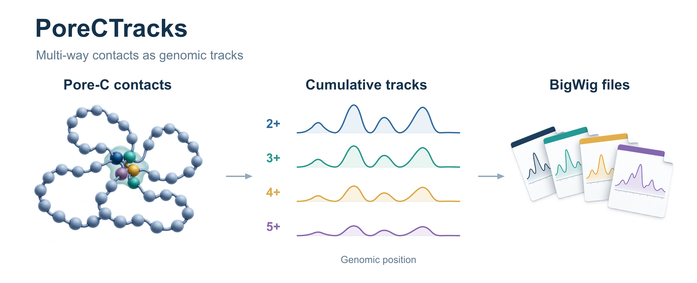

# PoreCTracks

[](https://github.com/wyqmath/PoreCTracks/releases/tag/v0.1.0)

PoreCTracks converts Pore-C contact sets into four one-dimensional genomic signal tracks. It exports standard BigWig files for genome browsers and downstream analysis, together with source-order statistics, genomic span distributions, and plots.



The default channels are **2+, 3+, 4+, and 5+**, using source sets of order 2 through 10. A higher-order set contributes to every applicable lower-order channel.

## Install and try the example

Requires Python 3.10 or newer.

```bash
python -m pip install .
porectracks build --contacts examples/contacts.tsv --chrom-sizes examples/chrom.sizes --bin-size 1024 --out example_tracks
porectracks plot --tracks example_tracks --region chrExample:0-16384 --out example_tracks/region
porectracks stats --tracks example_tracks --out example_tracks/distributions
```

Run these commands from the checkout directory. The example contains synthetic sets with known support, including a repeated member bin and a contact spanning two chromosomes. Output directories must be new or empty. Figures are saved as 300 dpi PNG and vector PDF. Use `--dpi` on `plot` or `stats` to choose another PNG resolution.

## Input

The input is a tab-separated table, optionally gzip-compressed, with one member interval per row:

```text
set_id	chrom	start	end	count
set1	chrExample	100	200	3
set1	chrExample	2100	2200	3
set1	chrExample	4200	4300	3
```

The example above represents one three-member set with support 3. `count` is an optional positive integer, defaulting to 1; repeat the same value on every row of a set. Consecutive rows must belong to the same `set_id` until that set is complete. Different sets can share members. Coordinate intervals use **0-based, half-open** notation, consistent with BED and BigWig.

Provide a two-column `chrom.sizes` file listing chromosome names and lengths. Member chromosome names must match this file. Each interval is assigned to the bin containing `floor((start + end) / 2)`. Repeated members in the same chromosome/bin are collapsed, while adjacent bins remain distinct. Set order is the number of distinct bins after this step. Use distinct IDs for distinct observations, or aggregate identical sets and supply their multiplicity as `count`.

Both cis sets (one chromosome) and trans sets (multiple chromosomes) contribute to the tracks. A trans set retains its full order across chromosomes. Span statistics use cis sets only.

## What the four signals mean

For a set S with k distinct members and support c(S), each member receives c(S)/k in every channel whose threshold m is at most k. Thus each source set supplies the same total support to each applicable channel. With the default maximum order 10:

| File | Source-set orders |
| --- | --- |
| `contact_2plus.bw` | 2–10 |
| `contact_3plus.bw` | 3–10 |
| `contact_4plus.bw` | 4–10 |
| `contact_5plus.bw` | 5–10 |

$$F_m(i)=\frac{10^6}{N}\sum_{S\ni i,\ m\leq |S|\leq K}\frac{c(S)}{|S|},\qquad m\in\{2,3,4,5\}.$$

Here K is `--max-order` (default 10), and N is the sum of source-set support over all accepted input sets, counted once per set. The same denominator is used for every channel and chromosome. The signal is **distributed support per million accepted source-set support per genomic bin**, stored as a constant over that bin. To recover support totals from the tracks, sum once per bin; a base-pair integral additionally weights by bin length.

This equals averaging all m-member projections of each eligible set, then sharing each projection's weight among its members. Neighboring cumulative differences recover exact order-2, order-3 and order-4 signal; the 5+ channel retains the combined high-order signal. Counts above the selected maximum are reported as excluded, and the cap can be raised with `--max-order`.

Use `--normalization raw` to export c/k contributions without scaling. For a regional input drawn from a larger sample, pass the same `--support-total N` for all regional runs so their intensity scales match. This denominator must be at least the support present in the input.

## Valid regions and blacklists

```bash
porectracks build --contacts contacts.tsv --chrom-sizes chrom.sizes --regions observed_regions.bed --blacklist blacklist.bed --out tracks
```

By default, the chromosome lengths define the observed territory: every genomic bin has an output value, including zero. For an input containing only part of the genome, provide `--regions` to specify its observed territory. A bin must be fully covered by the union of these intervals. Chromosome-end bins use their actual truncated length.

`--blacklist` masks any overlapping bin from the output. Masked bins and bins outside the observed territory are absent from the BigWigs and listed as missing in downstream reads. Valid bins with no contact support are explicitly stored as zero. The effective territory is exported as `valid_regions.bed`.

These options control output coverage. Source membership, order and normalization are calculated before the output mask. Source-order and span statistics describe all accepted input sets before this mask; metadata also reports the support retained in exported bins. Any upstream read filtering should be documented with the input dataset. BED intervals on chromosomes absent from `chrom.sizes` are counted in metadata and ignored, allowing a genome-wide blacklist to accompany a chromosome subset.

## Outputs and plots

A build produces four BigWigs, `valid_regions.bed`, `order_stats.tsv`, `span_distribution.tsv`, and `metadata.json`. Metadata records the software/dependency versions, coordinate and weighting definitions, normalization, excluded orders, valid-bin counts, support totals, and input basenames. `order_stats.tsv` separates cis/trans support at each exact source order. `span_distribution.tsv` records support for each exact cis binned span (largest member bin start minus smallest).

The default region plot shows the four Pore-C tracks, the genomic region, and axis units. The y-axis is contact intensity per genomic bin after normalization to one million source-set observations, counting multiplicity. For example, a value of 5 means that after scaling the reference total to one million, that bin receives 5 units of distributed contact support. Each source set contributes count/order to a member bin. Equivalently, sample a source-set observation in proportion to its count, then select one member uniformly: a value of 5 means 5 expected hits of that bin per million such draws. A threshold channel additionally requires the sampled source set to reach that order. All four tracks use the same reference total and y-scale; missing coverage appears as gaps. The plot region uses the same 0-based, half-open convention as the input.

```bash
porectracks plot --tracks tracks --region chr1:800000-1050000 --out tracks/region
```

For an additional ATAC annotation panel, supply `--atac signal.bw`. Its panel uses log(1 + the exact mean over covered bases in each full valid contact bin).

The distribution figure shows exact source-order composition and count-weighted cis span CDFs. Composition percentages use all accepted input support. Each CDF is normalized within its exact-order group (2, 3, 4, or 5 through K), and its y-axis is the percentage of support with span at most the x-axis value. Proportions along the genome can be derived from the intensities: for example, 5+/2+ measures high-order support share wherever 2+ is positive.

## Python use and tests

```python
from porectracks.core import build_tracks
metadata = build_tracks("contacts.tsv", "chrom.sizes", "tracks", bin_size=1024)
```

```bash
python -m unittest discover -s tests -v
```

Tests use independently enumerated subsets and hand-specified examples to check weighting, the shared denominator, masked/zero values, chromosome boundaries, trans contacts, and input validation. The builder streams sets and keeps four dense chromosome grids in memory. Runtime and memory depend on input size and bin resolution.

BigWig I/O uses [pyBigWig](https://github.com/deeptools/pyBigWig). The package follows the [Python packaging specification](https://packaging.python.org/en/latest/guides/writing-pyproject-toml/).
